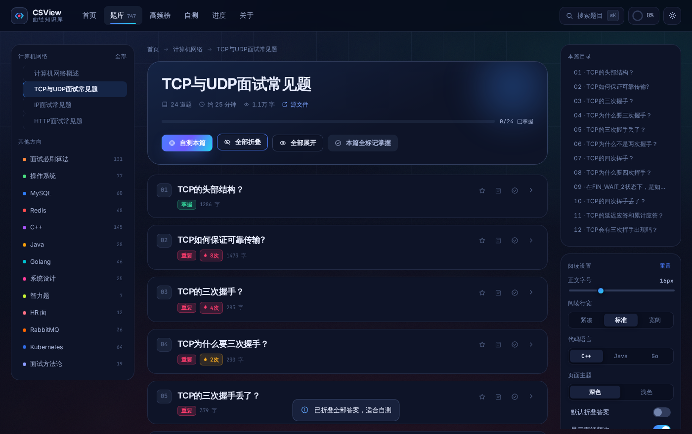
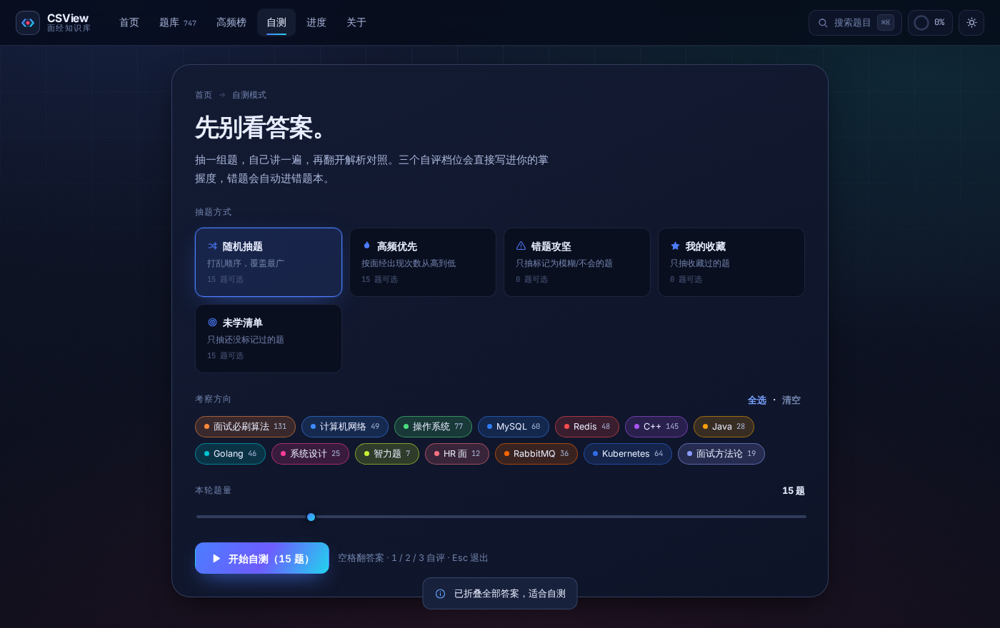
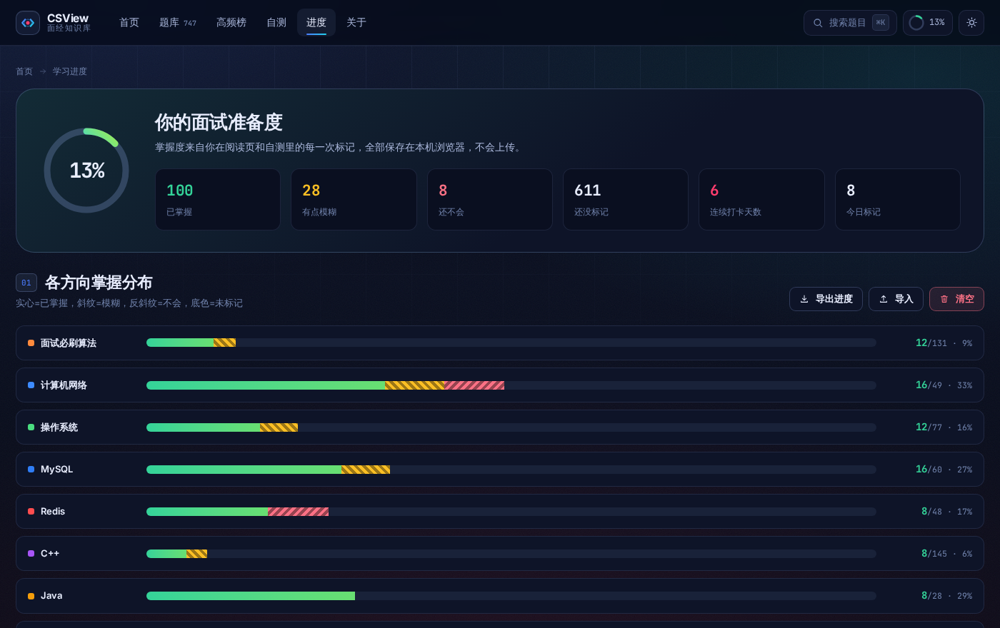

<div align="center">

# CSView Local

**把面经，练成肌肉记忆。**

一个跑在本地的计算机面试复习界面：读题、折叠自测、频次排序、掌握度追踪。

[快速开始](#快速开始) · [功能](#功能) · [快捷键](#快捷键) · [实现](#实现) · [内容版权](#内容版权与许可范围)

</div>

> [!IMPORTANT]
> **本仓库只包含界面代码，不包含任何面经内容。**
> 题目与解析全部来自 [zijing2333/CSView](https://github.com/zijing2333/CSView)，版权归原作者所有，
> 该作者明确声明禁止转载与搬运。因此内容不随本仓库分发，而是由你在本地执行 `npm run fetch`
> 直接从上游拉取，仅供个人学习使用。详见[内容版权与许可范围](#内容版权与许可范围)。

---

## 这是什么

CSView 把数百篇真实面经提炼成了高频题库，内容质量很高，但原站是 VuePress 文档站——适合「读」，不适合「练」。

这个项目保留全部内容，重做了阅读与练习的方式：

- 每一道题都是独立单元，可以**先折叠答案自己想一遍**，再翻开对照
- 三档自评（答得上来 / 有点模糊 / 还不会）直接写入掌握度，错题自动归集
- 把仓库里 15 份分散的题频记录**归并成一张可排序的高频榜**，并自动匹配到站内解析
- 全文检索、个人笔记、打卡与进度，全部保存在本机浏览器，不上传任何数据

构建后是纯静态产物 + 一个 90 行的 Node 静态服务器，没有数据库、没有后端、没有账号。

<table>
<tr>
<td width="50%"></td>
<td width="50%"></td>
</tr>
<tr>
<td align="center"><sub>阅读页 · 分册树 / 题目卡 / 目录与阅读设置</sub></td>
<td align="center"><sub>自测模式 · 五种抽题方式，键盘全程可操作</sub></td>
</tr>
</table>



<sub>进度页 · 掌握分布用实心、斜纹、反斜纹三种纹理编码，不依赖颜色也能区分</sub>

## 快速开始

需要 **Node.js ≥ 20**（用到原生 `fetch`）和 `git`（或 `tar`）。

```bash
git clone https://github.com/qin-js/csview-local.git
cd csview-local

npm install
npm run fetch     # 从上游拉取面经内容到 content/（不进入版本库）
npm run build     # 解析 markdown → 题目级 JSON，镜像图片，生成高亮
npm start         # → http://localhost:5173
```

换端口：`PORT=8080 npm start`。

`npm run fetch` 会把上游快照的 commit SHA 写进 `content/.source.json`，构建后在「关于」页可以看到内容来源与拉取时间。想更新内容：`npm run fetch -- --force && npm run build`。

## 功能

**题库与阅读**

- 14 个方向、68 篇分册、747 道题，按面试考察密度组织
- 题目级卡片：折叠答案、收藏、三档掌握度、个人笔记、字数与预计阅读时长
- 三栏阅读布局：左分册树、中正文、右目录 + 常驻阅读设置（字号、行宽、代码语言、主题、默认折叠、频次标注、背景动效）
- 目录随滚动高亮，顶部阅读进度条，锚点跳转落在导航栏下方
- C++ / Java / Go 三语言题解切换一次，全站记住选择
- Shiki 构建期高亮，深浅双主题；代码块一键复制；图片点击放大

**面经高频榜**

- 归并 15 份题频记录共 287 条问法，按出现次数排序
- 自动匹配到站内对应解析（含小节锚点直达），未匹配的如实标注「暂无对应解析」并可点击转为搜索
- 按方向筛选、关键词筛选、只看有解析 / 只看 ≥3 次

**自测模式**

- 五种抽题方式：随机、高频优先、错题攻坚、我的收藏、未学清单
- 方向多选 + 题量滑杆，答案默认隐藏，计时器记录思考时间
- 空格翻答案，`1` / `2` / `3` 自评，`→` 跳过，`Esc` 结束
- 结算页给出正确率、平均用时、分方向表现与错题清单，可一键只练错题

**搜索与进度**

- `⌘K` / `Ctrl+K` 全文检索：题干 + 全部解析建立本地索引，命中高亮、方向过滤、键盘导航
- 掌握度分布、连续打卡、收藏、错题本、笔记、自测记录
- 进度导出 / 导入 JSON，清空前二次确认且支持撤销

**其他**

- 深浅两套主题：深色是深空墨蓝 + 电光青，浅色是暖纸白，各自独立调过对比度
- 320px → 1920px 全视口无横向溢出；移动端目录与设置改为带遮罩的浮层
- HR 面与项目题没有标准答案，界面会提示你写下自己的版本

## 快捷键

| 按键 | 作用 |
| --- | --- |
| `⌘/Ctrl` + `K` 或 `/` | 打开搜索 |
| `Q` | 进入自测 |
| `T` | 切换深浅色 |
| `G` 然后 `H` | 回首页 |
| `Space` | 自测中翻开答案 |
| `1` / `2` / `3` | 自测三档自评 |
| `→` | 跳过当前题 |
| `Esc` | 关闭浮层 / 结束自测 |
| `⌘/Ctrl` + `Enter` | 笔记保存 / 搜索结果新标签打开 |

## 实现

```
tools/fetch.mjs     从上游拉取 markdown 到 content/，记录快照 SHA
tools/build.mjs     markdown-it + Shiki → 题目级 JSON、搜索索引、频次榜；镜像图片
server.mjs          静态服务器：gzip 预压缩缓存、ETag、SPA 回退、路径穿越防护
public/
  index.html        外壳与浮层容器
  styles.css        设计系统（深浅双主题、纹理图表、自定义滚动条）
  store.js          localStorage 状态 + 数据加载缓存
  ui.js             图标、toast、模态、正文增强（复制/代码页签/图片/脚注/内链）
  views.js          首页 / 分类 / 阅读 / 高频榜 / 自测 / 进度 / 关于
  app.js            路由、导航、搜索面板、全局快捷键
tools/verify*.mjs   Playwright 验收用例（136 项检查）
```

**构建期做的事**

1. 解析 frontmatter，按 `###` 切分题目（跳过代码围栏与容器内部），保留导语
2. 把 `<Badge>`、`::: tip/warning/danger`、`::: code-tabs` + `@tab`、脚注、emoji 短代码转成自有组件
3. Shiki 双主题高亮（`night-owl` / `github-light`），输出 CSS 变量供主题切换
4. 远端图片下载到 `public/img/`，失败的回落原始 URL 并在前端显示占位
5. 题频归并：字符 IDF 加权 + 二元组 Dice + 关键词守卫，把面经问法匹配到题目或小节锚点
6. 产出 `manifest.json`（123KB）、`search.json`（941KB，gzip 后约 305KB）、`rank.json` 与 68 个分册 JSON，按需懒加载

**运行时**：无框架、无构建步骤的原生 ES module SPA，hash 路由，`localStorage` 单一状态源。

## 开发

```bash
npm run build     # 重建内容产物
npm start         # 启动服务（默认 5173）
npm run verify    # 跑两套 Playwright 验收用例
```

`npm run verify` 需要先 `npx playwright install chromium`，或用 `CHROME_BIN` 指向已有的 Chrome/Chromium。
用例覆盖：路由与深链刷新、搜索、自测完整循环与重开、收藏/笔记/标记、导出导入与撤销、
8 种视口溢出扫描、定时器与监听器泄漏、浮层层级与移动端可达性。

## 内容版权与许可范围

- **代码**：MIT，见 [LICENSE](LICENSE)。仅覆盖本仓库的界面、构建管线与服务器代码。
- **内容**：题目、解析、图片均来自 [zijing2333/CSView](https://github.com/zijing2333/CSView)，
  版权归原作者所有。上游未提供开源许可证，且其 README 声明「禁止整合恶意搬运、分享，
  且严禁将网站内容整合搬运到任何公众号」。
  因此本仓库**不包含、不分发**任何面经内容；`content/`、`public/data/`、`public/img/`
  均在 `.gitignore` 中，由使用者自行从上游拉取，请仅用于个人学习。
- 原项目特别鸣谢 [小林 coding](https://xiaolincoding.com/)，本站复用内容的相应权利同样归属原作者。
- 若你是内容作者且对本项目有任何异议，请开 issue，我会立即处理。

## 致谢

内容与题库策划：[子敬](https://github.com/zijing2333)及 CSView 作者团队（枫长、LH、jjd、xmy、fawn、小羊）。
本仓库只是为这批内容重新做了一套本地阅读与自测界面。